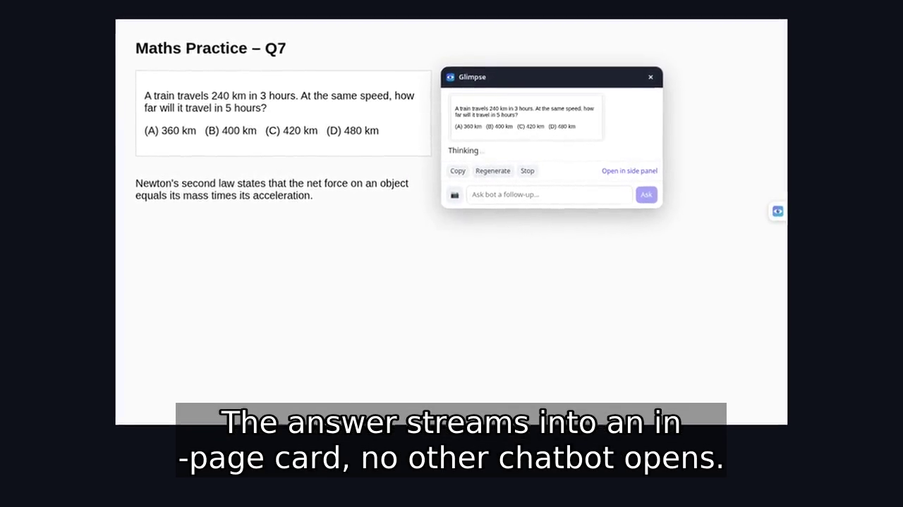
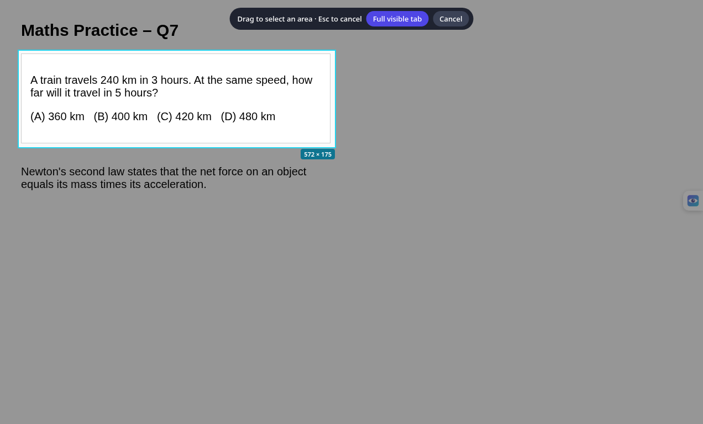
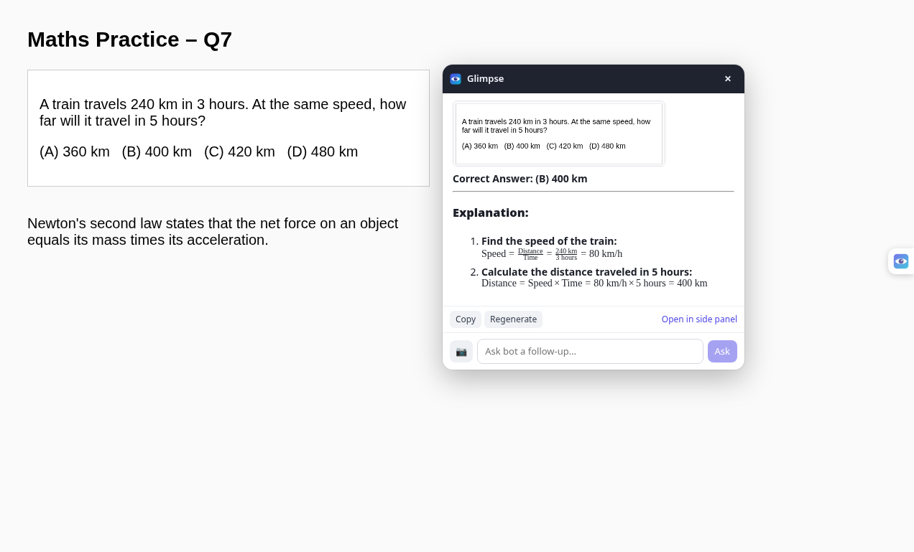
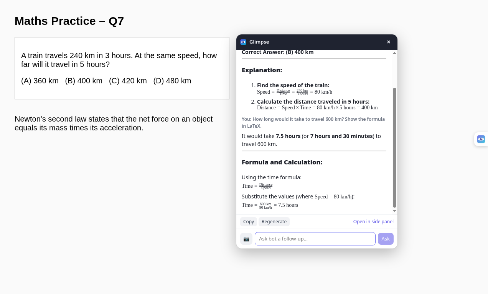
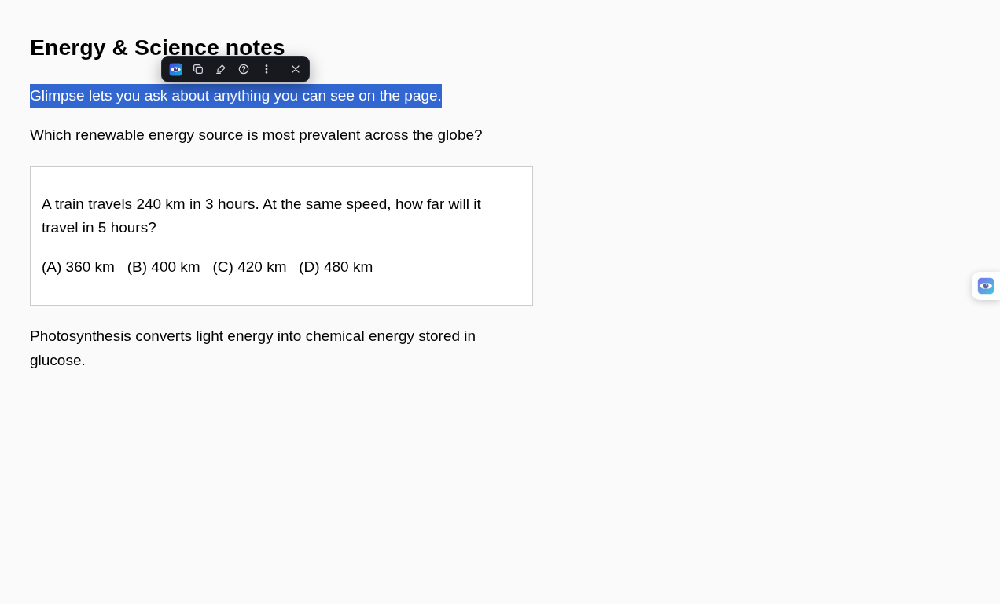
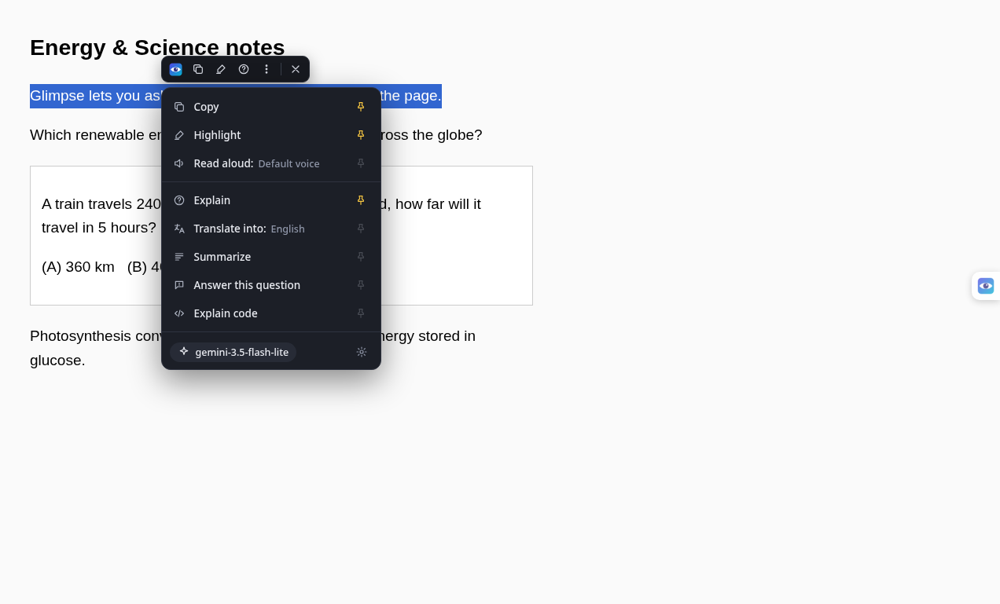
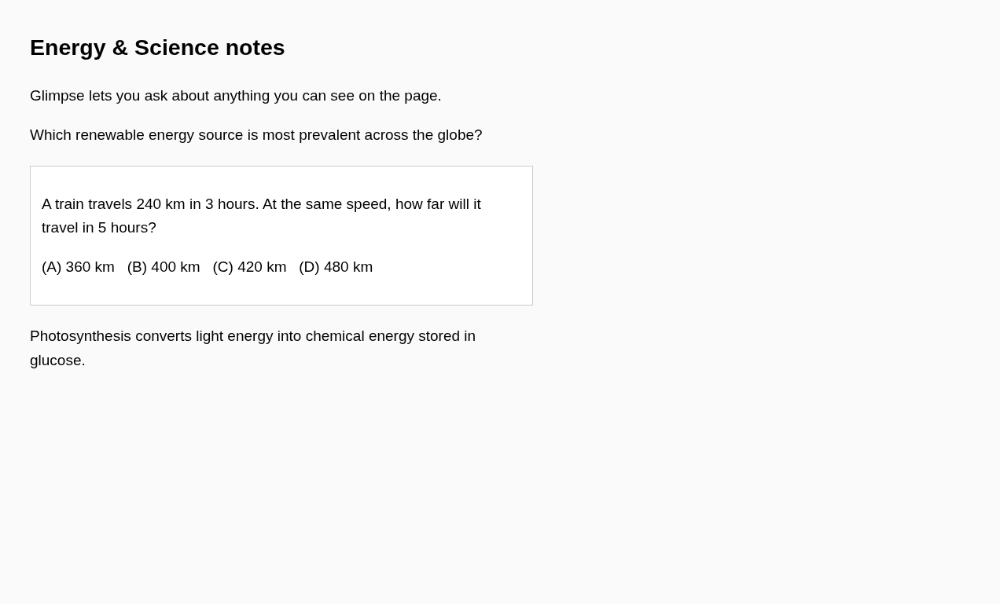
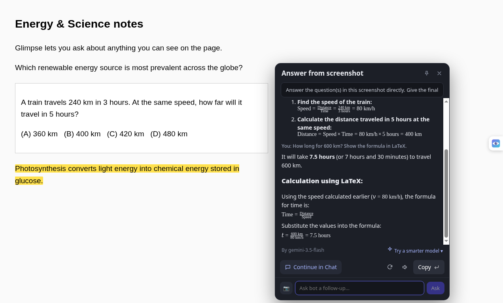

# Glimpse

**Ask questions about anything on your screen, and get the answer right in the page.**

Glimpse is a Chrome (Manifest V3) extension. Grab a region of the tab, select some text, or open the side panel, and Glimpse sends it to Google Gemini and shows the answer in a small card on the page. You don't need a separate chatbot tab.

> Version **0.2.0** · React + Vite + TypeScript

## Demo video

[](docs/glimpse-demo.mp4)

Video file: [`docs/glimpse-demo.mp4`](docs/glimpse-demo.mp4) (about 49 s, English subtitles burned in; captions also in [`docs/glimpse-demo.srt`](docs/glimpse-demo.srt))

---

## Features

### Screenshot Q&A
| Shortcut | Action |
|---|---|
| `Alt+Shift+S` | Drag to capture a **region** of the tab and ask about it |
| `Alt+Shift+F` | Capture the **full visible tab** |
| `Alt+Shift+G` | Open the **side panel** chat |



### In-page answer card
- The answer streams into a floating card. It runs in a shadow DOM, so page styles can't break it.
- **Ask bot**: ask follow-up questions in the same card.
- **Copy** and **Regenerate** buttons.
- **KaTeX** math rendering and syntax-highlighted code.
- **Continue in Chat**: move the conversation into the side panel.
- You can turn "Answer in page popup" off in Options to use the side panel instead.




### Selection toolbar
Select any text and a compact dark toolbar appears. Its **⋮ menu** has:

- **Copy**
- **Highlight** (saved per page and restored when you reload)
- **Read aloud** (text-to-speech)
- **Explain**
- **Translate** (pick the target language)
- **Summarize**
- **Answer this question**
- **Explain code**

You can **pin** any action to the toolbar. Result cards let you edit the prompt, choose a model in the **model picker** (for example, retry with a smarter model), regenerate, copy, or **Continue in Chat**.






### Gemini web search with fallback
When your key and plan allow it, Glimpse uses Gemini's Google Search grounding for up-to-date answers. If grounding isn't available (for example on some free-tier keys), Glimpse answers without it and shows a short note.

---

## Install

### Option A: prebuilt (fastest)
1. Download [`releases/glimpse-v0.2.0.zip`](releases/glimpse-v0.2.0.zip) and unzip it.
2. Open `chrome://extensions` and turn on **Developer mode**.
3. Click **Load unpacked** and pick the unzipped folder.

### Option B: build from source
```bash
git clone https://github.com/panther1345/Glimpse.git
cd glimpse
npm install
npm run build      # outputs to dist/
npm run zip        # optional: creates glimpse.zip from dist/
```
Then click **Load unpacked** in `chrome://extensions` and select `dist/`.

### Set up your Gemini key
1. Create a free API key in [Google AI Studio](https://aistudio.google.com/apikey).
2. Open Glimpse **Options** (right-click the toolbar icon, then Options) and paste the key.
3. Pick a default model. `flash-lite` is a good choice when your daily free quota for the main model runs out.
4. When asked, grant site access so Glimpse can show the card on pages. Access is optional and you can grant it per site.

You can change the shortcuts at `chrome://extensions/shortcuts`.

---

## Project structure
```
src/
  manifest.ts          MV3 manifest (commands, permissions, side panel)
  background/sw.ts     service worker: capture, routing, Gemini calls
  content/
    overlay.ts         region-selection overlay
    popup.tsx          in-page answer card (shadow DOM)
    selection.ts       selection toolbar and ⋮ menu
    highlight.ts       persistent highlights
    launcher.ts        floating launcher button
  sidepanel/           side panel chat (React)
  options/             options page (key, model, toggles)
  lib/                 storage, prompts, messages, providers, theme
scripts/               icon generation and content-script bundling
public/icons/          extension icons
docs/                  screenshots, demo video and subtitles
releases/              prebuilt zip
```

## Tech stack
- Chrome Extensions **Manifest V3** (service worker, side panel, `captureVisibleTab`)
- **React 19**, **TypeScript**, **Vite**
- `react-markdown`, `rehype-katex` / **KaTeX**, `rehype-highlight` / highlight.js
- `idb` (IndexedDB) for history
- **Google Gemini API** (default), plus optional OpenAI, Anthropic and custom-endpoint providers

## Privacy
- Your Gemini API key is stored **only locally** in `chrome.storage.local` on your device. It is never committed, synced or sent anywhere except Google's Gemini API.
- Screenshots and selected text go only to the Gemini API, and only when you ask.
- No analytics and no tracking. Host access is optional and you grant it yourself.

## Limits
- You need your own Gemini API key, and free-tier rate and daily limits apply.
- Web-search grounding may not be available on free keys. Glimpse then answers without it.
- It can't capture `chrome://` pages, the Chrome Web Store, or other protected browser pages.
- AI answers can be wrong, so check anything important.
- It has been tested on desktop Chrome and should work on Chromium browsers with side panel support.
